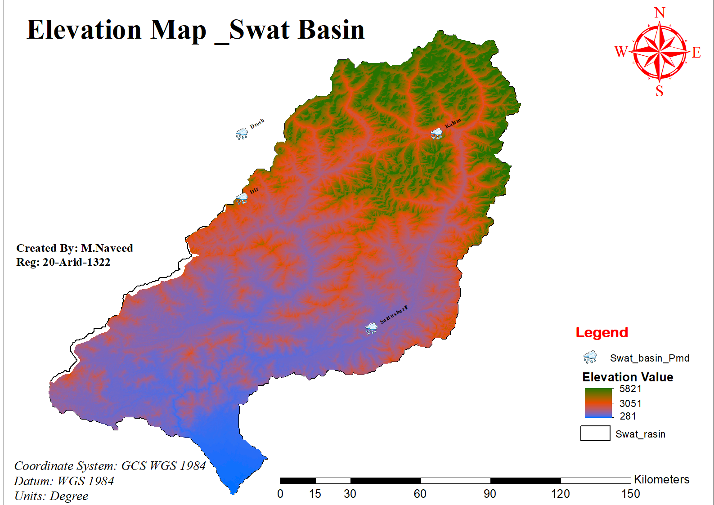
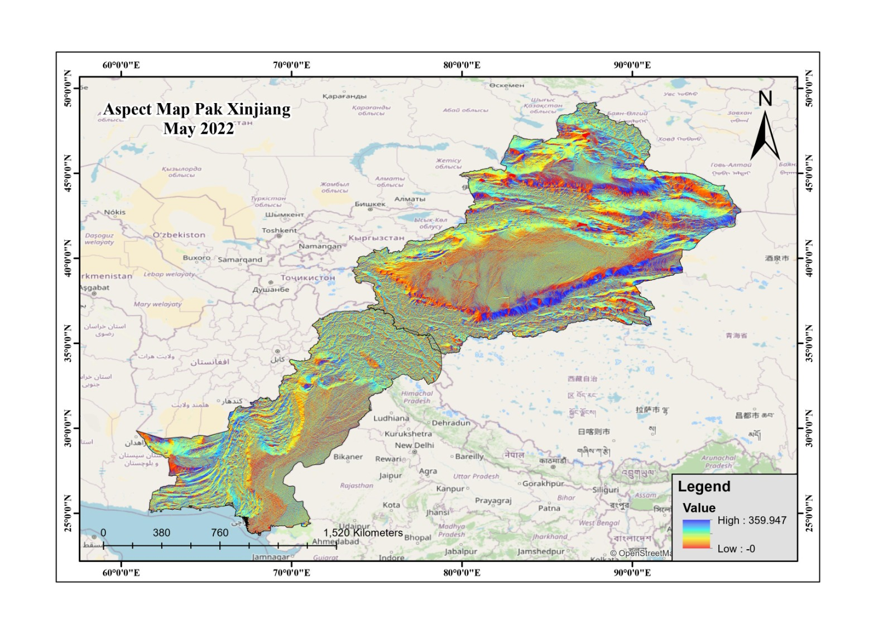
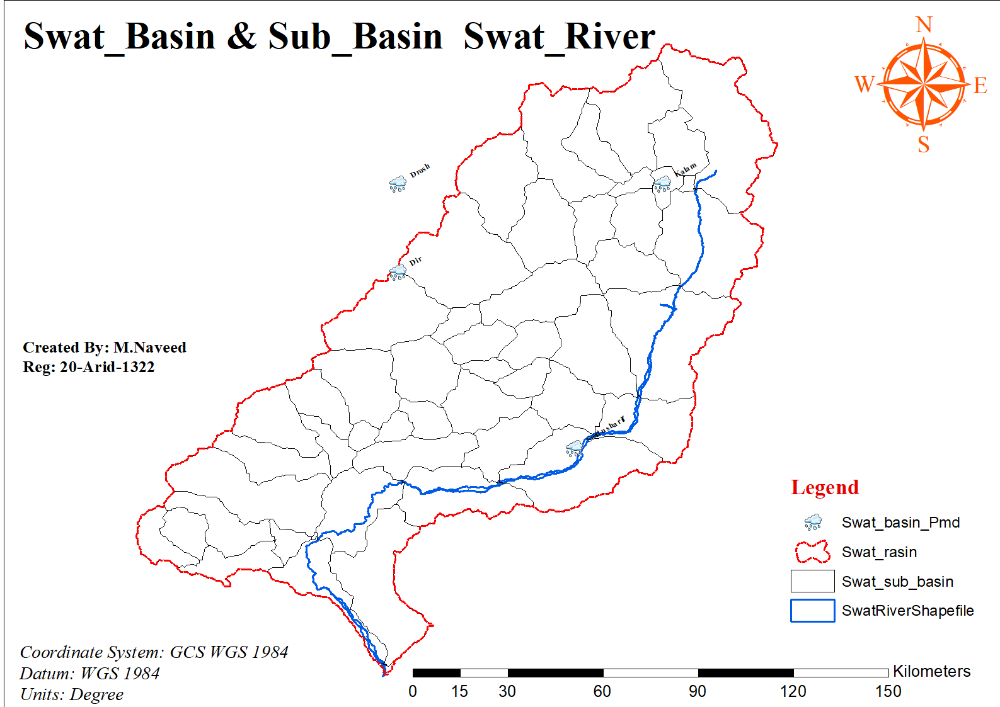
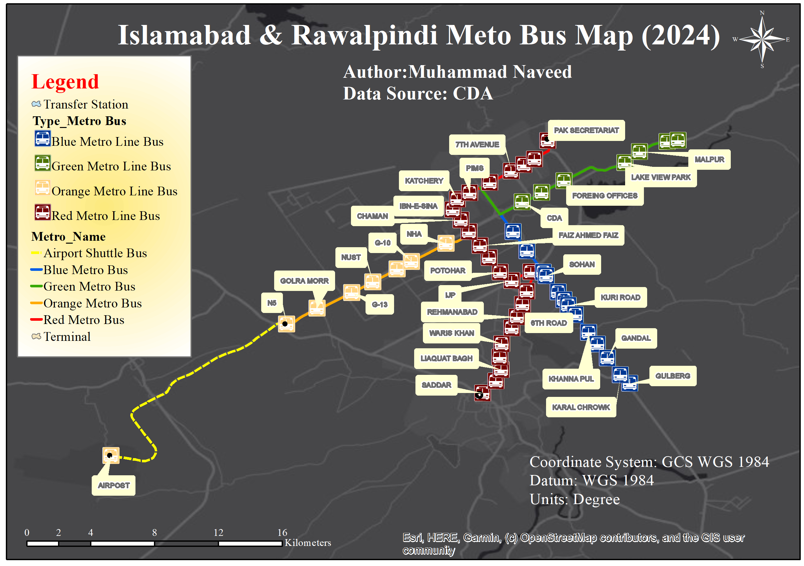

# GIS & Remote Sensing Map Collection

<!--  -->
<!-- Collage image placeholder - add collage.png to /Img folder -->

## About This Collection

This repository showcases a comprehensive collection of GIS and remote sensing maps covering various regions of Pakistan, including Punjab, Potohar Plateau, Swat River Basin, and Gilgit-Baltistan. The maps illustrate terrain analysis, hydrological features, soil characteristics, land use patterns, and environmental indicators using state-of-the-art geospatial analysis techniques.

## 📌 Note

- This repository contains geospatial maps focusing on terrain analysis, hydrology, soil science, and land cover classification across multiple regions in Pakistan.
- Click on each map to view the high-resolution version.
- Data sources, processing workflows, and code will be added soon.
- If you find these maps useful or use them in your research, please ⭐ give a star and share your feedback!
- **Contact:**
- 💼 LinkedIn: [www.linkedin.com/in/mnaveed186]
- **License:** [MIT / CC BY 4.0] - See LICENSE file for details

---

## 📑 Table of Contents

### Terrain & Topography
1. [Digital Elevation Model (DEM)](#1-digital-elevation-model-dem)
2. [Topography Map](#2-topography-map)
3. [Hillshade: Swat River Basin](#3-hillshade-swat-river-basin)
4. [Slope Analysis: Potohar](#4-slope-analysis-potohar)
5. [Slope Analysis: Swat River Basin](#5-slope-analysis-swat-river-basin)
6. [Aspect Map](#6-aspect-map)
7. [Aspect Map: Pakistan](#7-aspect-map-pakistan)

### Hydrology & Watershed
8. [Swat River Basin Map](#8-swat-river-basin-map)
9. [Drainage Density](#9-drainage-density)
10. [Watershed Analysis: Gilgit-Baltistan](#10-watershed-analysis-gilgit-baltistan)
11. [Alignment Density](#11-alignment-density)

### Soil Science
12. [Soil Temperature: Punjab](#12-soil-temperature-punjab)
13. [Soil Moisture: Punjab](#13-soil-moisture-punjab)
14. [Soil Type Classification: Punjab](#14-soil-type-classification-punjab)
15. [Soil Type: Potohar](#15-soil-type-potohar)

### Land Use & Environment
16. [Land Use/Land Cover: Potohar 2021](#16-land-useland-cover-potohar-2021)
17. [Crop Production](#17-crop-production)
18. [Evaporative Stress Index](#18-evaporative-stress-index)

### Regional & Geology
19. [Study Area (AOI) Map](#19-study-area-aoi-map)
20. [Geology Map: Potohar](#20-geology-map-potohar)
21. [Metropolitan Area](#21-metropolitan-area)

---

## Maps

### Terrain & Topography

#### 1. Digital Elevation Model (DEM)

This Digital Elevation Model provides a detailed representation of terrain elevation across the study region. The map was generated using [data source, e.g., SRTM 30m / ASTER GDEM] and processed to highlight elevation gradients, valley systems, and mountainous terrain. DEM analysis forms the foundation for hydrological modeling, slope analysis, and terrain characterization.

**Data & Tools:** [Data source: SRTM/ASTER] | [Tools: ArcGIS Pro, Google Earth Engine]

[⬆ Back to top](#gis--remote-sensing-map-collection)

---

#### 2. Topography Map

A comprehensive topographic map illustrating the physical landscape features including elevation contours, terrain relief, and major landforms. This map provides essential context for understanding the geomorphological characteristics of the region and serves as a base layer for spatial analysis.

**Data & Tools:** [Data source: topographic survey / DEM derivatives] | [Tools: ARCMAP, ArcGIS Pro]

[⬆ Back to top](#gis--remote-sensing-map-collection)

---

#### 3. Hillshade: Swat River Basin

Hillshade visualization of the Swat River Basin emphasizing terrain texture and relief patterns. The hillshade technique simulates illumination across the terrain surface, revealing subtle topographic features, drainage patterns, and landscape morphology that are critical for watershed analysis and environmental planning.

**Data & Tools:** [Data source: SRTM DEM] | [Tools: QGIS, ArcGIS Pro]

[⬆ Back to top](#gis--remote-sensing-map-collection)

---

#### 4. Slope Analysis: Potohar

Slope gradient analysis for the Potohar Plateau region, classifying terrain steepness into distinct categories. This map is essential for agricultural land suitability assessment, erosion risk analysis, and infrastructure planning. Steep slopes indicate higher erosion potential and constrain certain land use activities.

**Data & Tools:** [Data source: DEM-derived] | [Tools: QGIS, ArcGIS Pro]

[⬆ Back to top](#gis--remote-sensing-map-collection)

---

#### 5. Slope Analysis: Swat River Basin

Detailed slope classification map for the Swat River Basin highlighting gradient variations across the watershed. The analysis identifies areas prone to landslides, suitable for agriculture, and critical for hydrological modeling. Color-coded classification enables rapid assessment of terrain characteristics.

**Data & Tools:** [Data source: SRTM DEM] | [Tools: ArcGIS Pro]

[⬆ Back to top](#gis--remote-sensing-map-collection)

---

#### 6. Aspect Map

Terrain aspect (orientation) map showing the compass direction that slopes face. Aspect analysis is crucial for understanding solar radiation distribution, microclimate variations, vegetation patterns, and agricultural productivity. North-facing and south-facing slopes exhibit different environmental characteristics.

**Data & Tools:** [Data source: DEM-derived] | [Tools: QGIS]

[⬆ Back to top](#gis--remote-sensing-map-collection)

---

#### 7. Aspect Map: Pakistan

Regional-scale aspect analysis map covering a broader area in Pakistan. This map reveals the directional orientation of terrain across diverse physiographic regions, supporting climate studies, agricultural zoning, and renewable energy site selection (particularly for solar installations).

**Data & Tools:** [Data source: SRTM DEM] | [Tools: QGIS,Google Earth Engine]

[⬆ Back to top](#gis--remote-sensing-map-collection)

---

### Hydrology & Watershed

#### 8. Swat River Basin Map

Comprehensive map of the Swat River Basin delineating the watershed boundary, stream networks, and sub-basin divisions. The Swat River is a major tributary system, and this map supports hydrological modeling, water resource management, and flood risk assessment for the region.

**Data & Tools:** [Data source: DEM-based watershed delineation] | [Tools: ArcGIS Pro, QGIS, HEC-HMS]

[⬆ Back to top](#gis--remote-sensing-map-collection)

---

#### 9. Drainage Density

Drainage density map quantifying the total length of stream channels per unit area. High drainage density indicates fine-textured drainage networks, often associated with impermeable surfaces, steep slopes, or high precipitation. This metric is fundamental for watershed characterization and runoff prediction.

**Data & Tools:** [Data source: extracted from DEM] | [Tools: QGIS, ArcGIS Pro,HEC-HMS]

[⬆ Back to top](#gis--remote-sensing-map-collection)

---

#### 10. Watershed Analysis: Gilgit-Baltistan

Detailed watershed analysis for Gilgit-Baltistan, a mountainous region with complex hydrology and glacial influences. The map identifies sub-basins, stream orders, and watershed boundaries critical for water resource planning, hydropower development, and climate change impact assessment in high-altitude environments.

**Data & Tools:** [Data source: DEM, satellite imagery] | [Tools:ARCMAP, watershed modeling tools]

[⬆ Back to top](#gis--remote-sensing-map-collection)

---

#### 11. Alignment Density

Map depicting the density of linear features or structural alignments in the landscape. This analysis may represent geological lineaments, fault lines, or anthropogenic linear features. High alignment density can indicate tectonic activity, fracture zones, or infrastructure networks.

**Data & Tools:** [Data source: remote sensing imagery, geological surveys] | [Tools:ARCMAP, remote sensing analysis]

[⬆ Back to top](#gis--remote-sensing-map-collection)

---

### Soil Science

#### 12. Soil Temperature: Punjab

Soil temperature distribution map for Punjab province derived from remote sensing data. Soil temperature influences microbial activity, seed germination, and crop growth cycles. This map supports precision agriculture, crop calendar planning, and climate-smart farming practices.

**Data & Tools:** [Data source: MODIS Land Surface Temperature / Landsat thermal bands] | [Tools: Google Earth Engine, QGIS]

[⬆ Back to top](#gis--remote-sensing-map-collection)

---

#### 13. Soil Moisture: Punjab

Soil moisture map for Punjab showing spatial variability in water content across agricultural landscapes. Soil moisture is critical for irrigation scheduling, drought monitoring, and crop yield prediction. This map was generated using [satellite-based indices / field measurements / model outputs].

**Data & Tools:** [Data source: SMAP, Sentinel-1 SAR, or NDMI from optical sensors] | [Tools: Google Earth Engine, QGIS]

[⬆ Back to top](#gis--remote-sensing-map-collection)

---

#### 14. Soil Type Classification: Punjab

Comprehensive soil type classification map for Punjab based on texture, composition, and pedological characteristics. Different soil types exhibit varying water retention capacity, fertility, and suitability for different crops. This map is foundational for agricultural land use planning and soil conservation strategies.

**Data & Tools:** [Data source: soil survey reports, remote sensing classification] | [Tools: ArcGIS Pro, Google Earth Engine]

[⬆ Back to top](#gis--remote-sensing-map-collection)

---

#### 15. Soil Type: Potohar

Soil classification map specific to the Potohar Plateau region, an area known for its unique rainfed agricultural system. The map categorizes soils based on their physical and chemical properties, guiding sustainable land management and crop selection for this water-scarce region.

**Data & Tools:** [Data source: field surveys, satellite imagery] | [Tools: ARCMAP, ArcGIS Pro]

[⬆ Back to top](#gis--remote-sensing-map-collection)

---

### Land Use & Environment

#### 16. Land Use/Land Cover: Potohar 2021

Current land use and land cover (LULC) classification for the Potohar region as of 2021. The map identifies major land cover types including agriculture, forests, urban areas, barren land, and water bodies. LULC analysis is essential for monitoring environmental change, urban expansion, and agricultural intensification.

**Data & Tools:** [Data source: Landsat 8/9, Sentinel-2] | [Tools: Google Earth Engine, ARCGIS PRo, supervised classification (Random Forest)]

[⬆ Back to top](#gis--remote-sensing-map-collection)

---

#### 17. Crop Production

Spatial distribution of crop production patterns highlighting agricultural productivity zones. This map integrates yield data, cropping intensity, and land use patterns to identify high-productivity areas and regions requiring agricultural interventions or support.

**Data & Tools:** [Data source: agricultural statistics, NDVI time series, crop masks] | [Tools: Google Earth Engine,ArcGIS Pro]

[⬆ Back to top](#gis--remote-sensing-map-collection)

---

#### 18. Evaporative Stress Index

Evaporative Stress Index (ESI) map indicating water stress conditions across the landscape. ESI is derived from thermal remote sensing and measures the ratio of actual to potential evapotranspiration. Low ESI values indicate drought stress, making this map valuable for early warning systems and irrigation management.

**Data & Tools:** [Data source: MODIS/Landsat thermal data, meteorological inputs] | [Tools: Google Earth Engine, QGIS]

[⬆ Back to top](#gis--remote-sensing-map-collection)

---

### Regional & Geology

#### 19. Study Area (AOI) Map

Map showing the Area of Interest (AOI) or study region boundary with geographic context. This reference map provides the spatial extent and location of the research area, helping viewers understand the geographic scope of the analysis and its position within Pakistan.

**Data & Tools:** [Data source: administrative boundaries, GPS coordinates] | [Tools:ArcGIS Pro]

[⬆ Back to top](#gis--remote-sensing-map-collection)

---

#### 20. Geology Map: Potohar

Geological map of the Potohar Plateau showing rock types, geological formations, and structural features. Understanding the underlying geology is essential for groundwater exploration, mineral resource assessment, geotechnical investigations, and understanding landscape evolution.

**Data & Tools:** [Data source: Geological Survey of Pakistan, field mapping, remote sensing] | [Tools: QGIS]

[⬆ Back to top](#gis--remote-sensing-map-collection)

---

#### 21. TRANSIT MAP OF ISLAMABAD

An integrated route map of the Rawalpindi-Islamabad Metrobus network and its surrounding transportation lines. This urban mapping framework supports smart city planning and infrastructure development. It also plays a key role in analyzing population trends, tracking urban sprawl, and monitoring environmental impacts.

**Data & Tools:** [Data source: high-resolution satellite imagery, OpenStreetMap] | [Tools: QGIS, ArcGIS Pro, Google Earth Engine]

[⬆ Back to top](#gis--remote-sensing-map-collection)

---

If you have any questions, suggestions, or collaboration opportunities, feel free to reach out:
- 💼 LinkedIn: [www.linkedin.com/in/mnaveed186]

**Muhammad Naveed**  

---

⭐ **If you find this collection useful, please star this repository and share it with others!**

---

*Last updated: [Date]*
